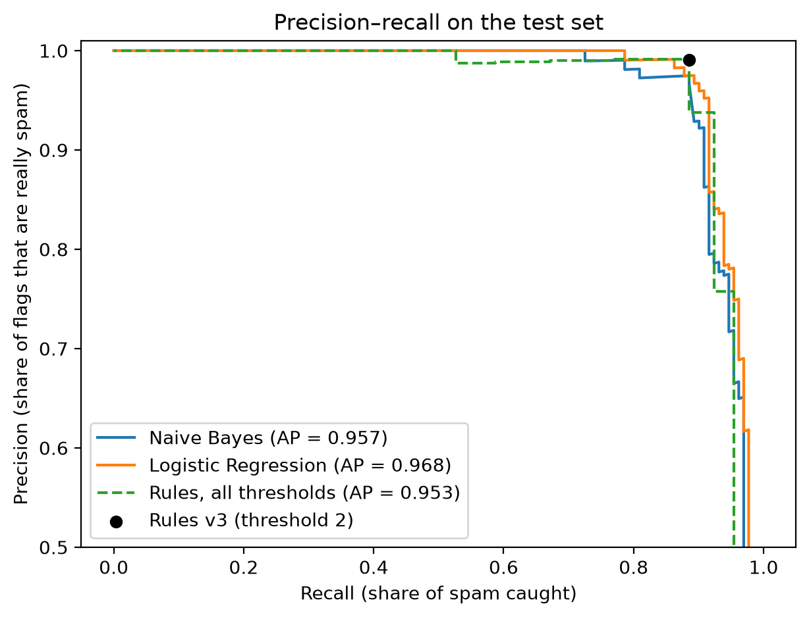

# Rule-Based vs. Machine Learning Spam Filter

Two SMS spam filters built on the same data and measured with the same code:

- **System A:** a hand-written rule-based filter (regex rules with weights and a threshold)
- **System B:** machine learning (TF-IDF + Naive Bayes / Logistic Regression)

Instead of describing the difference between traditional software and AI, this project **builds both and runs experiments** for each of four criteria: source of logic, accuracy and error, adaptation to change, and transparency.

Assignment for *Foundations of AI* (ხელოვნური ინტელექტის საწყისები), 3rd-year Computer Science.

## Dataset

[SMS Spam Collection](https://archive.ics.uci.edu/dataset/228/sms+spam+collection) (Almeida & Hidalgo, UCI Machine Learning Repository): 5,574 English SMS messages labeled ham or spam.

- ~400 exact duplicates were removed **before** splitting, so the same message can't appear in both train and test. Duplicates were mostly spam (spammers send identical texts to many people).
- Stratified 80/20 split (`random_state=42`): **4,136 train / 1,035 test**, ~12.6% spam in both.
- The rules were written and tuned on the training set only, then frozen and committed **before** the test set was used.

## Results on the test set

| System | False positives | Missed spam | Precision | Recall | F1 | Avg. precision |
|---|---|---|---|---|---|---|
| Rules (v3) | 1 | 15 | 0.991 | 0.885 | **0.935** | 0.953 |
| Logistic Regression | 1 | 19 | 0.991 | 0.855 | 0.918 | **0.968** |
| Naive Bayes | 0 | 38 | 1.000 | 0.710 | 0.830 | 0.957 |
| "Never spam" baseline | 0 | 131 | – | 0.000 | 0.000 | – |

The "never spam" baseline reaches **87.3% accuracy** while catching nothing, which is why the evaluation uses precision and recall instead of accuracy.



At their default settings the tuned rules slightly beat ML; across all thresholds (average precision) ML is slightly ahead. On accuracy, the two approaches are **essentially tied** on this dataset.

## The four criteria

### 1. Source of logic
- **Rules:** 16 weighted rules (13 regex patterns + 3 style checks) I wrote by reading training messages, refined over 3 tuning rounds (including fixing a bug where `won` matched "won't").
- **ML:** Logistic Regression has the same structure as my filter (weighted sum, compared to a threshold). The difference is who chooses the weights: I picked mine by hand; it learned one weight per word from labels.
- Its top spam words (`txt`, `call`, `free`, `reply`, `claim`, `150p`, `stop`, `won`) independently rediscover most of my rules.
- It also learned **dataset artifacts**: `lt` / `gt` (from the `&lt;#&gt;` placeholder used to anonymize numbers in ham messages) are among its strongest ham signals.

### 2. Accuracy and error
- Rules are deterministic with a handful of possible scores, so only a few precision/recall settings exist (stepped curve).
- ML outputs a probability, so the precision/recall trade-off can be set almost anywhere (smooth curve).
- Each rule change moved errors between the two columns of the confusion matrix:

| Rule version | Change | False positives (train) | Missed spam (train) |
|---|---|---|---|
| v1 | initial rules | 14 | 56 |
| v2 | fixed "won't" bug, split money/cash rules | 9 | 56 |
| v3 | lowered URL weight 1.5 → 1.0 (SMS-gateway footers like `fullonsms.com`) | 6 | 63 |

v3 was chosen because a lost real message costs more than a missed spam. The three style rules (`shouting`, `exclamations`, `long_message`) have low precision (31–41%), but with weight 0.5 they can never flag a message alone. Removing them would have been the next step, but the rules were frozen before testing, so they stayed.

### 3. Adaptation to change
Test spam was disguised with three tricks spammers use (share of spam caught):

| Trick | Rules | Naive Bayes | Logistic Regression |
|---|---|---|---|
| original | 0.89 | 0.71 | 0.85 |
| dotted words (`f.r.e.e`) | 0.85 | 0.60 | 0.69 |
| spaced numbers (`090 640 190 14`) | 0.73 | 0.70 | 0.85 |
| leetspeak (`fr33`) | 0.83 | 0.51 | 0.34 |
| all three | **0.56** | 0.50 | **0.21** |

Each system broke where its logic lives: spaced numbers defeated the phone-number regex; leetspeak turned ML's vocabulary into unseen words.

Cost of fixing ML: retrain with a few disguised training examples.

| Disguised examples added | 0 | 10 | 25 | 50 | 100 | 200 |
|---|---|---|---|---|---|---|
| LR recall on disguised spam | 0.21 | 0.67 | **0.88** | 0.92 | 0.94 | 0.96 |

Fixing the rules requires new code (text normalization) plus re-checking every rule for new false positives, and only works for tricks a developer has already noticed. Caveat: ML was retrained on the same tricks it was tested on, so this is its best case.

### 4. Transparency
For the same message (a ringtone spam):
- **Rules (white box):** exact reasons, e.g. `HAM (score 1 / threshold 2): mobile_offer`.
- **Logistic Regression (grey box):** per-word contributions (`ringtone +1.15`, `you have +1.03`, `order +0.90`): readable, but learned numbers rather than human reasons.
- **Naive Bayes treated as a black box:** remove one word at a time and measure the change in P(spam), the idea behind LIME/SHAP. Works without opening the model, but gives an approximate, after-the-fact explanation.

## Conclusion

**For an SMS spam filter I prefer ML as the core, with the highest-precision rules kept as a safety layer.**

- Accuracy doesn't decide it: the approaches are tied on this data.
- **Adaptation decides it.** Spam changes constantly. ML turns user "report spam" clicks into fixes with a retrain; rules need a developer for every new trick.
- **Rules capture concepts that bag-of-words ML can't see.** Every spam uses a different phone number, so ML never learns "phone number = spam", while one regex covers them all. Of the 14 test messages where the systems disagreed (all spam), the rules were right on 9, mostly adult chat-line spam with premium numbers, and LR on 5, softer spam without numbers or prices. That is why a hybrid makes sense: ML as the core, plus the four near-100%-precision rules (`phone_number`, `pricing_small_print`, `text_keyword`, `opt_out`) as a safety layer.
- **Rules win when there is no data**, e.g. Georgian-language SMS with no labeled dataset: start with rules, switch to ML once enough reports are collected.

## Project structure

```
spam_filter/
├── data/
│   ├── SMSSpamCollection      original UCI file
│   ├── train.csv              deduplicated training split
│   └── test.csv               deduplicated test split
├── notebooks/
│   ├── data_exploration.ipynb  Stage 1: loading, deduplication, split
│   ├── rules.ipynb             Stage 2: tuning the rule-based filter on train
│   └── ml.ipynb                Stages 3–8: ML, evaluation, explanations, drift
├── src/
│   └── rules.py               the rule-based filter (System A)
├── pr_curve.png
└── requirements.txt
```

## How to run

```bash
python -m venv .venv
.venv\Scripts\activate          # Windows
# source .venv/bin/activate     # macOS / Linux
pip install -r requirements.txt
```

Then run the notebooks in order: `data_exploration` → `rules` → `ml`.

Python 3.12, pandas, scikit-learn, matplotlib.

## Author

George Gegechkori ([@George-Gegechkori](https://github.com/George-Gegechkori))